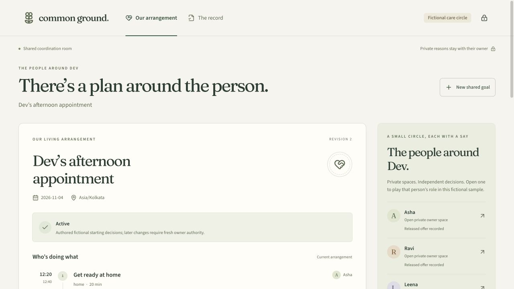

# Common Ground

**Make a plan together. Keep your private reasons yours.**

Common Ground is a local, fictional demonstration of a care arrangement that can change without discarding everything that still works. The shared room shows reviewed responsibilities, handoffs and calendar observations. Each person releases offers, keeps private structured memory, and makes exact decisions in a separate owner service.

The default interface is **living agreements v2**. The original v1 workflow and its accepted evidence remain available separately; no v1 signature authorizes v2 work.



The [independent browser record](docs/living-iab-development-qa.json) shows an actual local Nebius repair: one insert, one delete, and the retained pickup's exact event ID and ETag preserved across restart. All participants and decisions are fictional.

## Run the living sample

Requires Node 22 and Python 3.11. Install and build both interfaces:

```sh
uv venv --python 3.11 .venv
uv pip sync --python .venv/bin/python requirements.lock
npm ci
npm run build
```

For the demonstrated container boundaries, use an existing Linux Docker context and an explicitly fictional profile:

```sh
.venv/bin/python scripts/run_isolated.py \
  --context colima-passage \
  --profile cg-living \
  --runtime .runtime/isolated-living \
  --fictional-sample --build
```

Select a context that exists on your machine; the launcher does not change the default context. See [runtime isolation](docs/isolated-runtime.md) for topology, prerequisites and the actual-boundary check. The shared room is at [127.0.0.1:4301](http://127.0.0.1:4301), the broker API uses 4302, and the three owner origins use 4311–4313. These ports must be free; the launcher does not take ports from another process.

A Docker-free alternative uses ordinary local processes and provides a weaker, trusted-process boundary:

```sh
.venv/bin/python scripts/run.py --runtime .runtime/living-demo --fictional-sample
```

Use a new runtime directory when enabling fictional entry. An existing non-sample profile cannot silently become a public sample. Stop its supervisor with Ctrl+C. Keep its stores and volumes across restarts; do not delete state to recover an uncertain calendar operation.

## Try an arrangement that changes

1. Open the shared room and select **Try the fictional care circle**. Initial Asha, Ravi and Leena decisions are explicitly authored sample decisions. The optional authored carry-forward policy is unchecked by default. Starting another sample retains prior history, private memory and user-edited entries; it does not erase an existing owner policy.
2. Open Ravi's separate owner space, select only **Bring Dev home**, review the withdrawal and confirm it. His pickup remains committed. No private reason is requested or released.
3. Back in the shared room, choose the labeled **Local structured solver** or an explicitly authorized inference route. The local route makes no model call. A permitted question can invite Leena to consider the uncovered return; it cannot volunteer Asha for driving.
4. In Leena's owner space, inspect her exact offer and its recipients. Her return is conditional on Asha receiving Dev by **16:15**. Release that reviewed offer, then request the next arrangement in the shared room.
5. Review the selective delta. Leena decides on the new return. Asha must freshly review the changed direct counterpart even though her handoff time is unchanged. With carry-forward policies off, Ravi also gives exact review. A separately enabled policy permits only a fresh, narrow attestation for unchanged content, direct dependencies, recipients, complete coverage and cancellation scope.
6. Apply the approved revision. Retained pickup identity and creation provenance stay stable; the recorded repair requests deletion of Ravi's old return and insertion of Leena's return. Read the persisted mutations and readback receipts for the actual outcome. A partial or uncertain mutation sequence is not Active.
7. A refusal leaves an explicit help need. Requests respect private permission, refusal scope and a bounded question budget. A person must accept a fresh explicit invitation before a refused scope can be reopened.

An offer, an owner commitment, a verified calendar entry and a reported human handoff are different facts. Calendar verification does not establish attendance or completion. Session expiry, lost access and observation expiry make information historical or unconfirmed; re-entry and reconciliation are explicit.

## Bring a new goal and keep private context

**New shared goal** supports 2–6 registered participants and 2–12 responsibilities. Choose the local structured form, or separately allow the shared request to go to Fireworks or Nebius for draft extraction. The model draft establishes no confirmed facts or owner authority.

The editable review includes the subject, dates, timezone, duration, earliest start, latest end, places, named predecessor responsibilities and supporting source quotes. Directional journey durations are explicit reviewed inputs. Missing dates, durations, places or routes stay missing; the product does not invent them. Confirmation establishes a shared goal, after which each owner still reviews their own offer and commitments.

Each owner's **Private memory** tab supports reviewed capability exclusions, weekly capacity, request permissions, handoff deadlines and named-receiver requirements. Rules have provenance, scope, revision and optional expiry. Correcting or deleting a rule affects the next applicable decision and dependent authority. Deletion retains a content-free receipt. A separate private note stays in the owner's service and is never a public reason or model input. Standing carry-forward policies are optional, revocable and owner-local.

## Evidence and validation

The shared **The record** tab downloads sanitized v2 evidence and a standalone offline verifier. The verifier needs Python, `cryptography` and `rfc8785`; it needs no project imports, private keys, database or network. It verifies historical integrity and evidence bound to the listed owner keys, not independently established owner identity or human attendance.

```sh
npm test
npm run format:check
npm run test:living-ui
LIVING_QA_SAMPLE=1 LIVING_QA_FULL=1 npm run test:living-ui
LIVING_QA_APPROVAL=1 npm run test:living-ui
.venv/bin/python scripts/verify_living_evidence.py path/to/common-ground-living-evidence.json
```

The default browser command checks the public entry, credential-free recording and separate owner entry on running services. The explicit full command creates and changes a fictional sample, exercises owner review and memory, and injects a browser session-expiry response. Use a dedicated fictional profile. The approval mode uses a separate disposable authored runtime and checks exact signed approval feedback and invalidation; it does not touch the main runtime or call a provider. Reports are under `test-results/`. Browser/axe results are authored development checks, not an assistive-technology study.

The final local checks passed: **182 offline tests**, **33 automated browser views**, and **seven approval-feedback checks**. The [actual IAB proof](evidence/living-iab-proof.json) was downloaded through the UI and checked outside this checkout; the untouched copy passed and all eight rehashed tampered copies were rejected. See the [verification record](evidence/living-iab-proof.verification.json) and [final validation manifest](evidence/living-validation.json) for scope and limits.

Actual provider validation is explicit and may incur provider charges. It uses separate authored stores, in-process owner HTTP transports, actual external inference and persistent local calendar effects:

```sh
.venv/bin/python scripts/living_validation.py --provider fireworks
.venv/bin/python scripts/living_validation.py --provider nebius
```

Only the broker receives provider credentials. Routes require separate current owner grants; there is no silent fallback. Actual NVIDIA Nemotron Ultra on Nebius completed the conditional repair and a new two-owner, three-responsibility, two-date goal after explicit authored review. The first invalid Nebius repair was rejected and remains in the record. See [v2 validation](evidence/living-validation.json), the [actual v2 provider ledger](evidence/living-provider-usage.json) and [scripted proof](evidence/living-scripted-proof.json) for exact requests, outcomes, usage and scope. This qualifies the recorded local workflow, not Google accounts, human benefit or a deployed service.

The strong no-model baseline is reproducible separately:

```sh
.venv/bin/python scripts/evaluate_living.py
```

It compares CP-SAT with an independent fixed-time feasibility oracle on a frozen authored corpus of 60 development and 120 validation cases. Both partitions share one generator; they are not independently authored or sealed held-out cases. [Results and limits](evidence/living-planning-validation.json) include all assigned cases, genuine impossibility and information-limited cases. No model advantage is claimed.

## Recorded and legacy v1 workflow

[Inspect the recorded agreement](http://127.0.0.1:4301/?recorded=1) without any session or owner credentials. It displays the unchanged [original sanitized v1 snapshot](evidence/sample-proof.json), explicitly historical and expired. The [original evidence notes](evidence/README.md), [verification result](evidence/sample-proof.verification.json), [validation record](evidence/validation.json) and original provider attempts remain intact.

The interactive original source remains at `?legacy=1` on each service. `npm start` keeps the original `.runtime/` profile; its private launcher pairing links are in `.runtime/pairing-links.json`. Pair each origin separately. Pairing fragments are cleared, sessions expire, and locking clears that origin's session. Do not publish the launcher file or reuse v1 authority for a living agreement.

The legacy workflow releases structured preferences, proposes a complete appointment plan, obtains exact proposal/manifest approvals, and applies its local calendar entries. Its labeled fault fixtures exercise timeout-after-write, restart reconciliation and conditional compensation. Closing a legacy round and creating a new one remains a v1 operation; v2 uses stable commitments and selective amendments instead. Legacy-only calendar removal controls do not establish v2 edited-event recovery.

```sh
npm run test:ui
npm run test:live
.venv/bin/python scripts/live_validation.py --offline
.venv/bin/python scripts/verify_evidence.py evidence/sample-proof.json
```

`test:ui` explicitly selects the legacy interface. `test:live` is the original provider-validation script, separate from `living_validation.py`.

## Boundaries and limitations

The isolated runtime has actual separate container mounts, stores, capabilities and owner networks under **one host administrator**. It is not independently administered household/device isolation or a deployed security qualification. The Docker-free launcher remains a trusted-process sample. The fictional operator can intentionally switch roles.

The local v2 calendars are real separate SQLite stores. The optional [Google Calendar adapter](docs/calendar-adapters.md) has controlled HTTP-transport tests; it is not enabled in the sample and does not acquire OAuth authorization or connect real accounts. No live Google-calendar qualification is claimed.

User-edited v2 entries are preserved and require manual owner resolution. This release does not automatically re-adopt or remove an edited entry, so such an interruption cannot be described as automatic recovery. Readback/access failures remain unconfirmed rather than successful absence. Released information cannot be recalled.

There is no human study, household-impact result, clinical outcome, deployed latency result or guaranteed attendance claim. See [methodology and claims](docs/METHODOLOGY.md), the [living contract](docs/LIVING_CONTRACT.md), [legacy protocol/threat model](docs/PROTOCOL.md), [runtime isolation](docs/isolated-runtime.md), [calendar limits](docs/calendar-adapters.md) and [asset licenses](public/assets-manifest.json).
