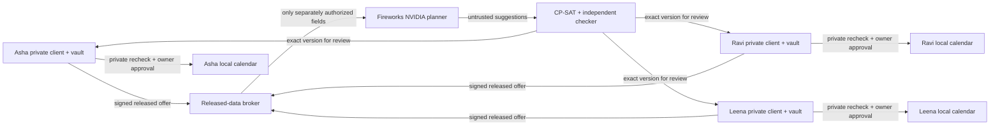

# Protocol and threat model

## Local boundaries

The shared React build is served on 4301 and the broker API on 4302. Asha 4311, Ravi 4312 and Leena 4313 each serve a separately built private client and own an encrypted preference vault, Ed25519 key, sessions, durable reservations/action intents and independent calendar SQLite database. The broker has a different database holding released protocol data. Its config contains only narrow owner coordination capabilities, public service URLs and its own interactive pairing secret.

The launcher is trusted setup code and can initialize all fictional roles. Random owner pairing codes remain in owner config and a private operator launch file, never broker HTML/API/model/export. Owner session capabilities are independent of broker coordination capabilities. Pairing needs the actual secret and the expected Origin. Private routes require the owner session; service routes reject browser Origins and accept only that owner's narrow capability. The broker cannot sign or approve. Loopback service clients ignore ambient proxies. Hosts are allowlisted against rebinding.

No cookies are used because cookies do not isolate ports. One-hour bearer sessions are stored under each browser origin with an explicit Lock action; unrelated origins cannot read them. JavaScript execution inside a trusted owner origin, hostile same-UID processes and OS administrators remain out of scope. File permissions and field encryption do not establish a process sandbox. Local transport is HTTP on loopback; remote deployment would require TLS and independently administered identities/devices.

## Signed messages and disclosure

`shared/protocol.py` uses vetted `rfc8785` canonical JSON and `cryptography` Ed25519. Envelopes bind message type, schema version, issuer, audience, circle, issued/expiry times, nonce, key ID, consent revision and payload. Releases additionally bind a fixed coordination purpose, exact fields/values, named human recipients, broker, separately named Fireworks permission and retention statement. Approval binds the exact immutable proposal digest, action-manifest digest, version, own action IDs, private-constraint revision, execution deadline and compensation policy. Its purpose is constrained to the same confirmed appointment goal and allowed task catalog by the owner validator. Withdrawals name the goal/offer and advance consent.

The recipient verifies the registered key, signature, audience/circle, strict schema, expiry and monotonic revisions. Exact retransmission after an acknowledgment loss returns the original recorded acceptance without another mutation. Reusing a message ID or nonce with different signed bytes fails. Revoked keys, stale revisions, altered manifests and expired windows fail closed. The same checks run again before inference transmission and owner dispatch. Historical evidence verification checks signature integrity at issuance; it never reactivates expired authority.

Only allowlisted released values enter the provider request. A circle-only grant is insufficient. Actual outgoing JSON is retained with a canonical hash; transmitted attempts receive a disclosure receipt. Private structured notes, source pointers, unrelated event titles, credentials and private-reason hashes have no broker read route. Canary/credential scans reject accidental outbound leakage; they are a bounded test, not a guarantee against semantic inference from already released availability.

Corrections are owner-confirmed and durable. They advance consent/constraint revisions, invalidate dependent approvals/releases and stop pending dispatch. A new release names the changed facts/recipients. Information previously received by recipients cannot be recalled; signed released history remains in the local audit.

## Solver and model authority

The sample's five task responsibilities, appointment times, durations and locations are confirmed inputs. Nemotron restates that graph, compares real eligible assignments and suggests a tradeoff. Suggestions provide search hints and the last objective only. They cannot approve, certify feasibility, sign or call a connector.

CP-SAT uses integer minutes, exactly-one assignments, optional intervals, owner capacity, precedence and 40-minute home/clinic transfer buffers. Owner temporal successor circuits compute actual adjacent travel cost. Lexicographic objectives are: preserve earlier task ownership; minimize owner-approved weighted minutes plus maximum owner load; minimize transfer minutes plus start delay; finally minimize deviations from model suggestions. A pinned seed and one search worker make runs reproducible. Each objective gets a five-second budget; only OPTIMAL establishes that level before fixing it. UNKNOWN is not INFEASIBLE. The independent ordinary-Python checker never imports the solver.

Each owner authenticates the stored exact approval before consulting private constraints, then checks the confirmed task catalog, own allowlist, availability, private conflicts, travel, manifest and current consent. A forged broker request cannot use prepare as a private-calendar oracle. These checks do not prove real-world truth or future attendance.

## Dispatch and recovery

Preparation stores owner-local interval reservations, expiry and monotonically increasing fences in a transaction. Competing agreements cannot reserve overlapping owner time. The broker commits its intent/outbox durably after all reservations are acquired. At-least-once delivery is expected.

The authorization point is an owner transaction that checks consent/constraint revisions, approval/grant/proposal expiry, lease, key and calendar preconditions, then stores a uniquely fenced intent. Withdrawal committed first blocks authorization. A withdrawal after authorization cancels unsent intents or reconciles effects. Send scheduling shares the owner's lock and rechecks immediately before transport. This is not an atomic transaction with an external calendar and cannot promise recall of a request already transmitted.

Action-derived deterministic event IDs prevent duplicates. After an ambiguous outcome the owner reads that event before retrying. Final verification observes current calendar fields/ETag rather than trusting a cached success status. Conditional compensation removes only the unchanged app-created version. Edited/missing/unconfirmed effects remain NEEDS_ATTENTION. Owner-only explicit review can resolve an edited local event using its current ETag; the broker's automatic compensation authority never broadens to delete edited content.

Fault controls exercise actual separate calendar storage: pre-write failure, timeout after a committed write, pause between durable intent and send, and conflicting user edit. They are labeled test fixtures, not Google Calendar responses. ICS files use the `icalendar` serializer, UTC instants, deterministic UIDs and explicit planned/verified/cancelled status. Importing an ICS elsewhere is a separate user action.
